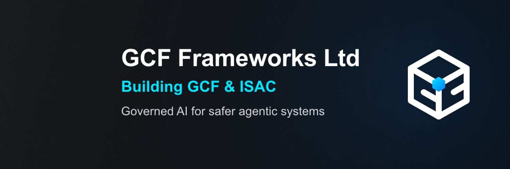
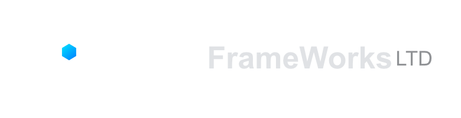
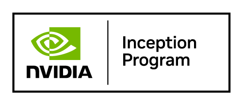

### Governed AI. Persistent intelligence. Controlled authority.

**The model is replaceable. The intelligence system is not.**

[Website](https://www.gcf-framework.com) · [News](https://www.gcf-framework.com/founder-notes/introducing-gcf-frameworks/) · [X](https://x.com/GCFFramework) · [LinkedIn](https://www.linkedin.com/company/146638099/) · [GitHub organisation](https://github.com/GCF-Frameworks) · [Email](mailto:billy.p@gcf-framework.com)

---

## About GCF Frameworks

**GCF Frameworks Ltd** is an independent UK company building **GCF**, the underlying intelligent system architecture for AI, and **ISAC**, the first AI product being built on it.

The work began in 2020 as a personal project to build an AI assistant that could remember context, help with real work and use tools on a computer. That assistant became ISAC, and the architecture it needed became GCF. The company was incorporated in England and Wales on 19 September 2026 (company number 17468924).

GCF Frameworks Ltd is a member of NVIDIA Inception.

## GCF — Governed Cognitive Framework

**GCF** is the underlying architecture of an intelligent AI system. It covers cognition, memory, governance, security, permissions, authority, tools and resources, and how those components work together. It is not a governance wrapper or a security layer added on top of a model.

GCF is model-independent: models are replaceable engines. Memory, authority and the written record belong to the system, so changing the model does not change what the system is permitted to do.

> **Capability does not equal authority.** A more capable model does not automatically gain permission to act.

GCF is designed around:

- Authority defined and held by the system, not granted by the model
- Tools and system access through controlled, permitted routes
- Models as replaceable parts, so an organisation is not tied to one provider
- Memory that belongs to the system and survives a change of model
- Budgets, resource awareness and a written record of actions for people to review
- Human oversight: people can review, step in and override

## ISAC — Intelligent Systems Architecture Core

**ISAC** is the first AI product being built on GCF. It is where GCF's architecture becomes something people can use and see working. ISAC is designed to remember, use tools and work across models, with GCF deciding what it is permitted to do.

ISAC is **in development and not yet available**. It is a pre-commercial product.

## Development status

These are internal engineering milestones, not external certification:

| Item | Status |
| --- | --- |
| GCF 2.0 baseline | Frozen |
| ISAC Stages 31–35 | Complete |
| Foundation Stable | Reached (internal milestone, 13 October 2026 development closeout) |
| Stage 36 · external and custom AI providers | In progress |
| ISAC Technical Preview Build 0.02A | In development; no date yet. A technical preview, not the formal ISAC product |

Testing so far has been internal, apart from one early build (0.01A) shared with a first external tester. We do not present planned capabilities as shipped products.

## Where we're focusing

| Area | Direction |
| --- | --- |
| **Private-sector AI** | Exploring governed AI for software teams, SMEs and organisations with sensitive systems or information. |
| **Secure infrastructure** | Investigating controlled integration with local computers, servers, private infrastructure and edge devices. |
| **Robotics and physical intelligence (future vision)** | Longer-term research only. No robotics product exists or is offered. |

## Engineering principles

- **Governance before execution** — the model may propose; a separate authority process determines what can proceed.
- **Human control** — defined oversight, escalation and interruption.
- **Model flexibility** — models can change without automatically widening permissions.
- **Local-first foundations** — privacy-conscious and resource-aware deployment.
- **Evidence before claims** — we keep internal testing separate from independent assurance and customer outcomes.

## Connect

- **Website:** https://www.gcf-framework.com
- **Email:** billy.p@gcf-framework.com
- **LinkedIn:** https://www.linkedin.com/company/146638099/
- **X:** https://x.com/GCFFramework
- **Organisation:** https://github.com/GCF-Frameworks
- **Based in:** Blackpool, United Kingdom
- **Registered office:** Cotton Court Business Centre, Church Street, Preston PR1 3BY

---

*Capability can change. Authority should remain governed.*

© 2026 GCF Frameworks Ltd.

© 2025 NVIDIA, the NVIDIA logo, and NVIDIA Inception are trademarks and/or registered trademarks of NVIDIA Corporation in the U.S. and other countries.

