### Governed AI. Persistent intelligence. Controlled authority.

**The model is replaceable. The intelligence system is not.**

[Website](https://www.gcf-framework.com) · [GitHub organisation](https://github.com/GCF-Frameworks) · [Email](mailto:billy.p@gcf-framework.com)

---

## About GCF Frameworks

**GCF Frameworks Ltd** is a UK-based technology company developing governed AI architectures and the systems built around them. Our focus is on making AI more persistent and useful while keeping permissions, tools and real-world actions under explicit control.

We believe improvements in AI should not depend on larger models alone. The architecture around a model matters too: how it handles state, resources, memory, tools, auditing and authority.

## What we're building

### ISAC — Intelligent Systems Architecture Core

**ISAC** is the first product being developed on GCF. It is intended to provide a persistent AI experience across tasks and, as development progresses, models and sessions, with governed access to systems and tools.

ISAC remains a **pre-commercial product in development**. Our current focus is on controlled product progression, external validation and commercial readiness.

### GCF — Governed Cognitive Framework

**GCF** is the underlying architecture for coordinating AI cognition, memory-related components, resource management and authority controls. It is designed around a simple principle:

> **AI capability does not automatically grant permission to act.**

Our approach includes:

- Model-independent governance and modular model coordination
- Resource-aware local AI execution
- Permission and policy controls for tool and system access
- Auditability, risk controls and human oversight
- Memory and identity architecture developed through explicit product stages
- Support for future private, server and edge environments

## Where we're focusing

| Area | Direction |
| --- | --- |
| **Private-sector AI** | Exploring governed AI workflows for software teams, SMEs and organisations with sensitive systems or information. |
| **Secure infrastructure** | Investigating controlled integration with local computers, servers, private infrastructure and edge devices. |
| **Robotics and physical intelligence** | Parallel research into assistive and industrial robotics, plus potential hardware-backed authority controls. |

Robotics and specialist GCF hardware are **research and development directions**, not released commercial products.

## Development status

As documented in our **13 October 2026 development closeout**, ISAC Stages 31–35 reached the internally certified **Foundation Stable** milestone, following revalidation and benchmarking. This refers to an **internal engineering milestone**, not independent security certification.

Subsequent ISAC stages, product features and external security evaluation remain subject to development and validation. We do not present planned capabilities as shipped products.

## Engineering principles

- **Governance before execution** — the model may propose; a separate authority process determines what can proceed.
- **Human control** — retain defined oversight, escalation and interruption mechanisms.
- **Model flexibility** — underlying models can change without automatically widening permissions.
- **Local-first foundations** — value privacy-conscious and resource-aware deployment.
- **Evidence before claims** — distinguish internal technical testing from independent assurance and customer outcomes.

## Connect

- **Website:** https://www.gcf-framework.com
- **Email:** billy.p@gcf-framework.com
- **Organisation:** https://github.com/GCF-Frameworks
- **Location:** United Kingdom

---

*Capability can change. Authority should remain governed.*

© 2026 GCF Frameworks Ltd.

